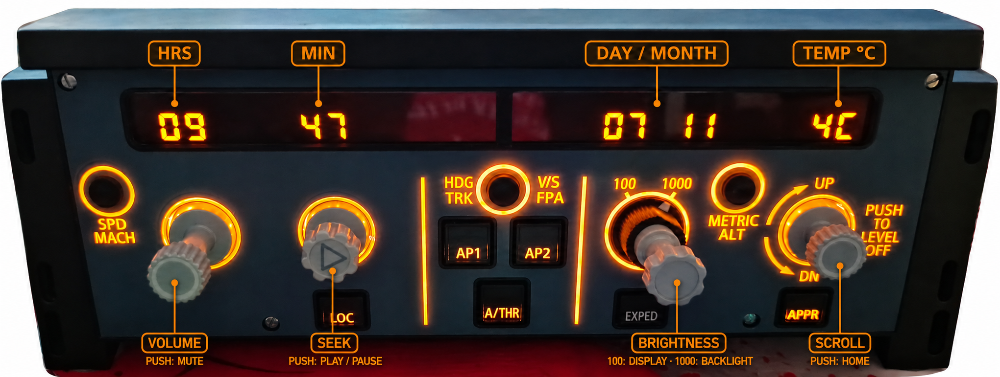

# FCU_CLOCK

Use a **WINCTRL 32 FCU** as a standalone clock and desktop controller.



## Status

- **Windows 10/11:** original native implementation preserved
- **Linux:** HID clock and desktop backend implemented; hardware-tested on Arch Linux / KDE Plasma 6 / Wayland. See the compatibility table below.
- **License:** GPL-3.0-or-later

The USB display/input protocol is shared across platforms. One project supports both operating systems and selects the desktop backend automatically.

**Installation:** [Windows](#install-and-run-on-windows) · [Linux](#install-and-run-on-linux)

## What the displays show

| FCU display | Desktop value |
|---|---|
| SPD | Local hour; temporarily shows application volume (`0–100`) for 3 seconds after turning the SPD knob |
| HDG | Local minute |
| ALT | Local date as `DD MM` |
| V/S | Current outdoor temperature for the configured location |

## Default controls

| FCU control | Action |
|---|---|
| SPD/MACH button (far left) | Show the desktop on all monitors; press again to restore windows |
| SPD knob | Change the foreground application's volume |
| SPD PUSH | Mute/unmute the foreground application |
| HDG knob | Left/Right arrow, for example seek in YouTube |
| HDG PUSH | Media Play/Pause |
| ALT knob, selector at `100` | Display brightness |
| ALT knob, selector at `1000` | Button and encoder backlight brightness |
| V/S knob | Mouse wheel up/down |
| V/S PUSH | Home key |

## Requirements

- WINCTRL 32 FCU connected by USB
- Python 3.11 or newer
- Windows 10/11, or Linux with a local graphical session

> [!IMPORTANT]
> Close MobiFlight and SimAppPro before starting FCU_CLOCK. Only one program can control the FCU HID device at a time.

## Install and run on Windows

```powershell
git clone https://github.com/smokeflypaper/FCU_CLOCK.git
cd FCU_CLOCK
python -m pip install -e .
fcu-desktop discover
fcu-desktop clock
```

Use `Ctrl+C` to stop it. Run `fcu-desktop clock --once` for a single display update and hardware check.

## Install and run on Linux

The program runs as your normal desktop user. Python dependencies are isolated in `.venv`.

### 1. Install system dependencies

Use the commands for your distribution (Python **3.11+** required):

```bash
# Arch Linux
sudo pacman -S --needed python python-pip base-devel linux-api-headers libpulse

# Ubuntu 24.04+ / Debian 12+
sudo apt install python3 python3-venv python3-dev build-essential linux-libc-dev pulseaudio-utils

# Fedora
sudo dnf install python3 python3-devel gcc kernel-headers pulseaudio-utils
```

PipeWire with its PulseAudio compatibility service, or PulseAudio, must be running for volume controls. These commands install the `pactl` client, not a replacement audio server.

### 2. Download and install

```bash
git clone https://github.com/smokeflypaper/FCU_CLOCK.git
cd FCU_CLOCK
python3 -m venv .venv
.venv/bin/python -m pip install -e .
```

If you are testing the Linux branch before it is merged, run `git switch feature/linux` after cloning and before installation.

### 3. Allow access to the FCU and virtual keyboard

```bash
sudo install -m 644 packaging/linux/70-fcu-clock.rules /etc/udev/rules.d/70-fcu-clock.rules
sudo modprobe uinput
printf 'uinput\n' | sudo tee /etc/modules-load.d/fcu-clock.conf
sudo udevadm control --reload-rules
sudo udevadm trigger --subsystem-match=misc --sysname-match=uinput
```

Unplug/reconnect the FCU, then log out and log in again. These rules use systemd-logind to grant the active local user access to this FCU and `/dev/uinput`. The latter permits simulated keyboard/mouse input. No world-writable device rules or membership in the broad `input` group are needed. On systems without systemd-logind, configure equivalent device access through your distribution's seat manager. Do not run FCU_CLOCK with `sudo`.

### 4. Enable foreground application volume

- **KDE Plasma 6 (Wayland):** install [kdotool](https://github.com/jinliu/kdotool) and `qdbus6` (Arch: `qt6-tools`; other distributions may call it `qdbus-qt6`). If kdotool is not packaged for your distribution, build it using Rust/Cargo and the D-Bus development headers:

  ```bash
  # Build dependencies: Arch: rust pkgconf dbus; Debian/Ubuntu: cargo pkg-config libdbus-1-dev
  cargo install --git https://github.com/jinliu/kdotool --locked
  ```

- **X11:** install `xdotool` from your distribution.
- **Other Wayland desktops:** SPD controls the default audio output. Identifying another application's process is compositor-specific; there is no universal foreground-process API.

When the active application has no matching audio stream, SPD falls back to the default output. Application matching includes child processes (for example browser audio processes), but sandboxed applications may hide or remap their process IDs. The SPD display temporarily shows the resulting volume in percent.

### 5. Check and launch

```bash
./scripts/run-linux.sh doctor
./scripts/run-linux.sh clock --once
./scripts/run-linux.sh
```

`doctor` checks access without changing the FCU display or sending keys. `clock --once` writes the display and exits. The final command keeps the clock and controls running; stop with **Ctrl+C**. Start only one instance. Close any simulator software that owns the FCU first.

To keep the clock running after closing the terminal (systemd user session), stop the foreground instance with Ctrl+C first, then run:

```bash
./scripts/run-linux-background.sh
systemctl --user status fcu-clock
journalctl --user -u fcu-clock -n 50 --no-pager
```

This starts a background service, retains error logs, and restarts the program after an unexpected failure. It does not enable automatic startup at login. To stop it, use `systemctl --user stop fcu-clock`; to restart it, use `systemctl --user restart fcu-clock`. Do not run the foreground launcher at the same time. Weather and desktop environment settings from the launching terminal are passed to the service.

For clock and FCU brightness only, use `./scripts/run-linux.sh clock --no-controls`. This does not require access to `/dev/uinput` or an audio server.

Set weather coordinates before launch; no location is assumed or committed:

```bash
export FCU_CLOCK_LATITUDE="50.0755"
export FCU_CLOCK_LONGITUDE="14.4378"
./scripts/run-linux.sh
```

These example coordinates are Prague. Without coordinates, the clock runs with temperature unavailable.

To keep your location across restarts, create `~/.config/fcu-clock/config.env` (or `$XDG_CONFIG_HOME/fcu-clock/config.env`):

```bash
FCU_CLOCK_LATITUDE=50.0755
FCU_CLOCK_LONGITUDE=14.4378
```

Both Linux launchers load this local shell configuration and export its values. Values in this file override those inherited from the terminal. Keep it outside the repository and only put trusted shell assignments in it.

### 6. Optional automatic startup after login

On KDE and other desktops integrated with systemd's `graphical-session.target`, create `~/.config/systemd/user/fcu-clock.service` with the following contents. Replace `/absolute/path/to/FCU_CLOCK` with your actual checkout path; keep the quotes if the path contains spaces.

```ini
[Unit]
Description=FCU CLOCK desktop clock and controls
After=graphical-session.target
PartOf=graphical-session.target
StartLimitIntervalSec=0

[Service]
Type=simple
ExecStart="/absolute/path/to/FCU_CLOCK/scripts/run-linux.sh" clock
Restart=on-failure
RestartSec=3

[Install]
WantedBy=graphical-session.target
```

Stop any foreground instance first. If you used the temporary background launcher, stop its service before reloading:

```bash
systemctl --user stop fcu-clock.service  # Ignore "not loaded" if it has never run
systemctl --user daemon-reload
systemctl --user enable --now fcu-clock.service
systemctl --user status fcu-clock.service
```

FCU_CLOCK now starts with your graphical session after each login and stops at logout. It retries after a device/access failure, so a disconnected FCU can be plugged in later. It loads the same private weather configuration described above. Once installed, use `systemctl --user restart fcu-clock` rather than the temporary background launcher. To disable automatic startup, run `systemctl --user disable --now fcu-clock`.

This setup was verified on KDE Plasma. If your desktop does not activate `graphical-session.target` or import its display environment into the user service manager, use that desktop's autostart settings instead.

### Linux compatibility

| Feature | KDE Plasma 6 Wayland | X11 | Other Wayland desktops |
|---|---|---|---|
| Clock, date, weather, FCU brightness | Yes | Yes | Yes |
| Arrows, Home, media key, wheel | uinput | uinput | uinput |
| Foreground application volume | kdotool + pactl | xdotool + pactl | Default output volume |
| Show/restore desktop | KDE MinimizeAll (D-Bus) | Desktop shortcut | Desktop shortcut if supported |

Only Arch/KDE/Wayland has been tested with physical hardware here. Automated tests cover Linux behavior and Windows regression cases; the CI workflow runs on Windows and Ubuntu. Other desktop environments still need real-world validation.

On KDE, FCU_CLOCK prefers the built-in **Minimize All** KWin script, which minimizes windows and restores the same set on the next press. Enable it in System Settings → Window Management → KWin Scripts if needed. Without it, the program falls back to KDE's peek-at-desktop mode; some focus policies/effects can dismiss that mode immediately.

Outside KDE, show-desktop sends `Super+D`. Configure that shortcut in your desktop, or set `FCU_CLOCK_DESKTOP_SHORTCUT=ctrl+alt+d` for desktops using that binding. GNOME may require configuring a show-desktop shortcut/extension. Media key behavior depends on your desktop's media integration.

If a desktop action fails, an error is printed and the clock keeps running. Check `doctor` and the message in the terminal. A USB disconnect stops the program with a useful error; reconnect and restart it. Linux uses the `hidraw` module when provided by hidapi, avoiding libusb claiming the kernel HID interface; libusb-only builds use the included USB permission rule.

## Customize FCU_CLOCK

FCU_CLOCK is intentionally small and easy to modify. At the moment mappings are edited in Python; there is no graphical configuration editor yet. Make a copy of the project or create a Git branch before experimenting, then restart FCU_CLOCK after every change.

### 1. Map a control to an existing action

The default mapping lives in [`src/fcu_desktop/controls.py`](src/fcu_desktop/controls.py):

```python
ACTION_MAP = {
    "MACH": "show_desktop",
    "SPD DEC": "volume_down",
    "SPD INC": "volume_up",
    "SPD PUSH": "volume_mute",
    "HDG DEC": "left",
    "HDG INC": "right",
    "HDG PUSH": "media_play_pause",
    "VS DEC": "scroll_down",
    "VS INC": "scroll_up",
    "VS PUSH": "home",
}
```

The action names already available on Windows are:

| Action name | Result |
|---|---|
| `show_desktop` | Press `Win+D` |
| `volume_down`, `volume_up` | Change the foreground application's volume |
| `volume_mute` | Mute/unmute the foreground application |
| `media_play_pause` | Send the global media Play/Pause key |
| `left`, `right`, `home` | Send that keyboard key |
| `scroll_up`, `scroll_down` | Send one mouse-wheel step |

For example, this makes `AP1` Play/Pause and `AP2` show the desktop:

```python
ACTION_MAP = {
    # Keep any mappings you still want here.
    "AP1": "media_play_pause",
    "AP2": "show_desktop",
}
```

Every physical input name that can be used on the left side is listed in [`src/fcu_desktop/inputs.py`](src/fcu_desktop/inputs.py):

```text
MACH, LOC, TRK, AP1, AP2, A/THR, EXPED, METRIC, APPR
SPD DEC, SPD INC, SPD PUSH, SPD PULL
HDG DEC, HDG INC, HDG PUSH, HDG PULL
ALT DEC, ALT INC, ALT PUSH, ALT PULL
VS DEC, VS INC, VS PUSH, VS PULL
ALT 100, ALT 1000
```

`DEC` and `INC` mean turning an encoder left or right. `PUSH` and `PULL` are the two encoder button directions.

> [!NOTE]
> `ALT DEC`, `ALT INC`, `ALT 100` and `ALT 1000` are currently intercepted by `DesktopController` for FCU brightness. They cannot be reassigned only by changing `ACTION_MAP`; remove or modify that brightness block in `controls.py` first.

### 2. Add another keyboard key

Windows virtual-key codes are defined in [`src/fcu_desktop/system_actions.py`](src/fcu_desktop/system_actions.py). Add a new entry to `VIRTUAL_KEYS`, then use its name in `ACTION_MAP`.

This example turns `LOC` into the otherwise rarely used `F13` key, which is useful for OBS, Discord, AutoHotkey or another application with its own shortcut settings:

```python
# system_actions.py
VIRTUAL_KEYS = {
    # Existing entries stay here.
    "f13": 0x7C,
}
```

```python
# controls.py
ACTION_MAP = {
    "LOC": "f13",
}
```

Useful virtual-key codes include `F13`–`F24` (`0x7C`–`0x87`), `Page Up` (`0x21`), `Page Down` (`0x22`), `End` (`0x23`) and `Space` (`0x20`). Microsoft maintains the full [Windows virtual-key code list](https://learn.microsoft.com/en-us/windows/win32/inputdev/virtual-key-codes).

### 3. Add a keyboard shortcut

Add a named branch inside `WindowsActions.invoke()` before its final `else` block. This example opens File Explorer with `Win+E`:

```python
# system_actions.py, inside WindowsActions.invoke()
elif action == "open_explorer":
    self._backend.hotkey(0x5B, 0x45)  # Win + E
```

Then assign it to a control:

```python
# controls.py
ACTION_MAP = {
    "AP1": "open_explorer",
}
```

### 4. Launch an application

First add the standard-library import at the top of `system_actions.py`:

```python
import subprocess
```

Then add an action inside `WindowsActions.invoke()`:

```python
elif action == "open_notepad":
    subprocess.Popen(["notepad.exe"])
```

Map it to any unused button:

```python
ACTION_MAP = {
    "AP2": "open_notepad",
}
```

For another application, replace `notepad.exe` with its executable path. Always use a list of arguments rather than building one long command string.

### 5. Run your own PowerShell script

Add another action to `WindowsActions.invoke()`:

```python
elif action == "run_my_script":
    subprocess.Popen(
        [
            "powershell.exe",
            "-NoProfile",
            "-File",
            r"C:\Tools\my-script.ps1",
        ]
    )
```

Then map it, for example, to `A/THR`:

```python
ACTION_MAP = {
    "A/THR": "run_my_script",
}
```

Only run scripts you wrote or trust.

### 6. Configure weather for your location

FCU_CLOCK deliberately does not contain a built-in location. Set your latitude and longitude before launching it:

```powershell
$env:FCU_CLOCK_LATITUDE = "50.0755"
$env:FCU_CLOCK_LONGITUDE = "14.4378"
fcu-desktop clock
```

Those example coordinates point to Prague. For a permanent private launcher, put the two `set` commands in your local `.cmd` file.

```bat
@echo off
set "FCU_CLOCK_LATITUDE=50.0755"
set "FCU_CLOCK_LONGITUDE=14.4378"
fcu-desktop clock
```

### More customization ideas

| FCU control idea | Possible desktop use |
|---|---|
| `LOC` / `APPR` | Previous/next browser tab or media track |
| `AP1` / `AP2` | Launch two favorite applications |
| `A/THR` | Run a microphone mute script |
| `EXPED` | Open Task Manager or Windows Task View |
| `METRIC` | Switch audio device using your own script |
| Encoder `PULL` actions | Undo/redo, copy/paste, fullscreen or screenshot |
| Unused encoder rotation | Zoom, brush size, timeline scrubbing or application-specific shortcuts |
| `F13`–`F24` mappings | Trigger OBS scenes, Discord controls or automation software without conflicting with normal keys |

Windows actions are implemented in [`src/fcu_desktop/system_actions.py`](src/fcu_desktop/system_actions.py); Linux actions are in [`src/fcu_desktop/linux_actions.py`](src/fcu_desktop/linux_actions.py). Runtime selection is in `platform_actions.py`. The Windows customization examples above apply to Windows; add Linux key codes/actions to `linux_actions.py` for Linux. Hardware input names and transitions are decoded in [`src/fcu_desktop/inputs.py`](src/fcu_desktop/inputs.py), while mapping and FCU brightness behavior live in [`src/fcu_desktop/controls.py`](src/fcu_desktop/controls.py).

ALT brightness is handled separately in `DesktopController`, because it sends brightness commands directly back to the FCU rather than invoking an operating-system action.

## Development

```powershell
python -m pip install -e .
python -m unittest discover -s tests -v
```

## Credits and license

FCU_CLOCK is licensed under **GPL-3.0-or-later**. USB report encoding was derived from the GPL-3.0 project [schenlap/winwing_fcu](https://github.com/schenlap/winwing_fcu).
